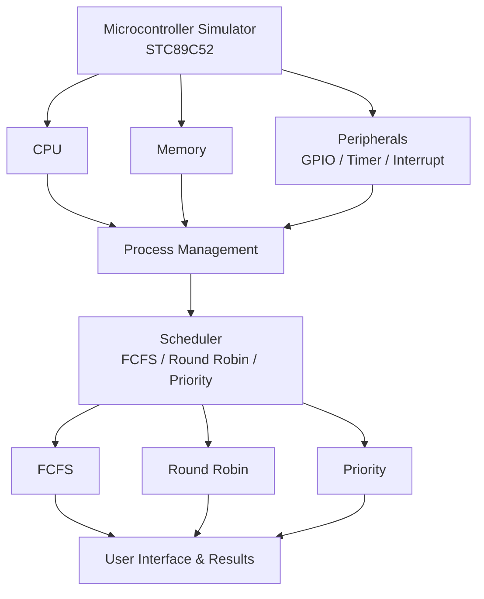

# Team-ThanthrashakthiProject title:
## Educational 8-bit Microcontroller Simulator with Process scheduling

## Problem Objective: To create a simple simulator for the STC89C52 microcontroller that shows how  instructions are executed, how memory and peripherals works  , and how multiple programs are managed by the CPU using different scheduling methods.

## Problem Statement: Design and implement a Java-based simulator for the STC89C52 8-bit microcontroller that models instruction execution, memory ,stack, GPIO , timer,and interrupts .The simulator will also manage multiple processes using PCB,queues,context switching,and FCFS, round robin,and Priority scheduling algorithms.

## Project scope: 
- CPU & Instructions – Simulate CPU registers, flags, PC, and instruction execution.
- Memory & Stack – Manage program memory, data memory, and stack operations.
- Peripherals – Simulate GPIO, timer, and interrupts.
- Process Management – Manage multiple programs using PCB and process states.
- Data Structures – Use stack, queue, circular queue, and instruction lookup table.
- Scheduling – Implement FCFS, Round Robin, and Priority scheduling.
- Context Switching – Switch between processes and save their states.
- User Interface – Support program loading, run, reset, and single-step execution.
- Performance Analysis – Measure waiting time, turnaround time, response time, context switches, and CPU utilization.

## Microcontroller being simulated:SCT89C52

## Team Members:
              Venkateshwara U D - 25190152
              Zainaba Fidha K N - 25190155
              Yathiksha U S - 25190153
              Raaif Abdul Haamid - 25190140

## Team responsibilities:
- Venkateshwara U D : CPU and instruction execution
- Zainaba Fidha K N : Memory and stack
- Yathiksha U S : Data structures(DSA)
- Raaif Abdul Haamid : User intertface and context switching

## Selected programming language: JAVA

## Initial System Architecture

## Initial development plan:
## Week 1 – Project Setup and planning
- Finalize project requirements and architecture.
- Set up Java project and GitHub repository.
- Define team responsibilities.
## Week 2 – Initial simulator development
- Implement STC89C52 CPU structure.
- Implement registers, PC, flags, and instruction cycle.
- Implement the required instruction subset with lookup and execution.
- Initial implemented 8 instructions.
## Week 3 –  Memory, Stack and queue
- Implement program memory (ROM) and data memory (RAM).
- Implement stack with PUSH,POP and stack pointer handling.
- Implement queue for managing instructions and processes.
- Test memory,stack and queue operations.
## Week 4 – Process communication and process intergration
- Implementation process creation and inter-process communication.
- Intergrate the CPU,memory,stack and queue modules.
- Develop the UI process , core process and logging.
-  Test the full simulator end to end.

## Compilation and Execution
## for compile
- javac -d bin (Get-ChildItem -Path src -Recurse -Filter *.java | Select-Object -ExpandProperty FullName)
## 1st terminal
- java -cp bin logging.LoggingProcess
## 2nd terminal
- java -cp bin cpu.CoreProcess
## 3rd terminal 
- java -cp bin ui.SimulatorUI 
## logging
-  Get-Content simulation.log
